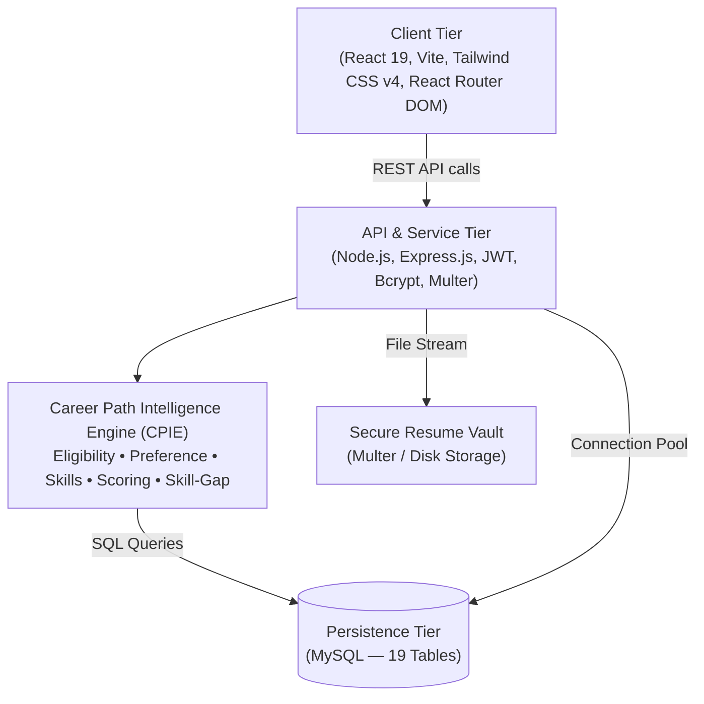

# PlaceWise — Multi-College Career & Placement Intelligence Platform

[](https://nodejs.org/)
[](https://www.mysql.com/)
[](https://react.dev/)
[](server/tests)
[](LICENSE)
[](https://github.com/daniyaa1/PlaceWise)

> **"Your AI-Powered Campus Career Intelligence Engine"**

PlaceWise is a production-grade, full-stack web application that solves a real campus placement problem: students don't know which drives they're eligible for, miss opportunities due to CGPA/branch/backlog mismatches, and have no intelligent system guiding their career decisions.

It unifies **on-campus recruitment drives** with **verified off-campus opportunities**, audits real-time academic eligibility through a custom intelligence engine, and provides transparent, explainable recommendations — all through a stunning glassmorphic dark/light UI.

---

## 📋 Table of Contents

1. [Product Vision & Problem](#1-product-vision--problem)
2. [System Architecture](#2-system-architecture)
3. [Tech Stack](#3-tech-stack)
4. [CPIE — Career Path Intelligence Engine](#4-cpie--career-path-intelligence-engine)
5. [Database Schema](#5-database-schema-19-tables)
6. [Backend API Reference](#6-backend-api-reference)
7. [Frontend — Pages & UI](#7-frontend--pages--ui)
8. [Role-Based Access Control](#8-role-based-access-control)
9. [Demo Accounts](#9-demo-accounts)
10. [Installation & Local Setup](#10-installation--local-setup)
11. [Deployment](#11-deployment)
12. [Testing](#12-testing)
13. [Project Structure](#13-project-structure)
14. [Key Design Decisions](#14-key-design-decisions)
15. [Known MVP Boundaries](#15-known-mvp-boundaries)

---

## 1. Product Vision & Problem

### The Problem
Traditional college placement systems have three critical flaws:

1. **Siloed Campus Visibility** — Students only see companies visiting their own campus and miss off-campus opportunities, graduate programmes, and national hiring drives.
2. **Branch Stereotyping** — Systems wrongly infer career interest from engineering branch (e.g., assuming Mechanical students only want core engineering roles).
3. **Opaque Ineligibility** — Students rarely understand *why* they were cut off or which skills would have made them competitive.

### The PlaceWise Solution

- **Dual Opportunity Sources** — Campus drives AND verified external jobs, with clear provenance for each.
- **Four Explicit Preference Modes** — `TECHNICAL`, `NON_TECHNICAL`, `BOTH`, `OPEN_TO_ALL`. Preference **never** changes eligibility.
- **CPIE Engine** — 5-module intelligence engine: eligibility → preference → skill match → score → skill-gap impact.
- **Multi-College Architecture** — Built to support multiple institutions, not tied to any single college.
- **Explainable AI** — Every recommendation score has a human-readable reason.

---

## 2. System Architecture

```
Browser (React 19 + Vite)
        │
        │  HTTPS REST / JSON
        ▼
Express.js REST API (Node.js — Port 5005)
        │
        ├──► CPIE Intelligence Engine (service layer)
        │         ├── eligibilityEngine.js
        │         ├── preferenceMatcher.js
        │         ├── skillCompatibility.js
        │         ├── recommendationEngine.js
        │         └── skillGapAnalyzer.js
        │
        ├──► MySQL Database (19 relational tables)
        │
        └──► Secure Resume Vault (Multer file storage)
```



---

## 3. Tech Stack

| Layer | Technology |
|---|---|
| **Frontend Framework** | React 19, Vite |
| **Styling** | Tailwind CSS v4 (custom glassmorphism design system) |
| **Routing** | React Router DOM v6 |
| **Icons** | Lucide React |
| **HTTP Client** | Axios (via `api.js` service layer) |
| **Backend** | Node.js, Express.js |
| **Authentication** | JWT (`jsonwebtoken`) + bcrypt (password hashing) |
| **File Uploads** | Multer |
| **Database** | MySQL 8 — raw SQL, no ORM |
| **Testing** | Node.js native `node:test` runner |
| **Dev Tools** | Vite (port 3000), nodemon (port 5005), MySQL (port 3307) |
| **Frontend Deploy** | Vercel |
| **Backend Deploy** | Render |
| **Database (Cloud)** | Aiven / Railway (MySQL) |
| **Version Control** | Git + GitHub |

---

## 4. CPIE — Career Path Intelligence Engine

The core product feature. Five modular, independently testable service files inside `server/src/services/cpie/`.

### Module 1 — `eligibilityEngine.js`

Returns one of **three deterministic states** for every student–opportunity pair:

| State | Meaning |
|---|---|
| `ELIGIBLE` | Student meets all hard eligibility criteria |
| `NOT_ELIGIBLE` | Fails at least one hard criterion (confirmed failure) |
| `NEEDS_VERIFICATION` | Data incomplete — cannot confirm either way |

**Hard criteria checked:**
- Engineering branch match (opportunity's allowed branches list)
- Graduation year match
- Minimum CGPA threshold
- Active backlog restriction (`no_backlogs_required` flag)
- College scope (CAMPUS-only, SELECTED_COLLEGES, OPEN_TO_ALL)
- Application deadline not passed

> ⚠️ `NOT_ELIGIBLE` always overrides `NEEDS_VERIFICATION`. A confirmed failure is never softened.

### Module 2 — `preferenceMatcher.js`

Maps the student's selected career mode to opportunity sections:

| Student Mode | Recommended Section | Explore Section |
|---|---|---|
| `TECHNICAL` | Technical preference group | Non-technical group |
| `NON_TECHNICAL` | Non-technical preference group | Technical group |
| `BOTH` | Both groups combined | None |
| `OPEN_TO_ALL` | All eligible opportunities | None |

> ⚠️ A student's engineering branch **never** determines their preference. A CSE student can prefer Management. A Mechanical student can prefer Software.

### Module 3 — `skillCompatibility.js`

- Computes what percentage of an opportunity's **desirable** skills the student already has
- Desirable skills **never** fail eligibility — they only boost the recommendation score
- Required skills are checked separately in the eligibility engine

### Module 4 — `recommendationEngine.js`

Produces an **explainable score (0–100)** for every eligible opportunity:

$$\text{Score} = 0.40P + 0.35K + 0.15W + 0.10L$$

| Component | Weight | What it measures |
|---|---|---|
| **P** — Preference fit | 40% | Does this match the student's career mode? |
| **K** — Skill compatibility | 35% | Desirable skill overlap percentage |
| **W** — Work mode match | 15% | Remote / Hybrid / Onsite preference alignment |
| **L** — Location match | 10% | Student's preferred location vs opportunity city |

Each score card includes a **human-readable explanation** surfaced in the UI.

### Module 5 — `skillGapAnalyzer.js`

- Aggregates missing **desirable** skills across ALL currently eligible opportunities
- Ranks by frequency (how many eligible roles need this skill)
- Shows ROI impact: learning Skill X unlocks N more opportunities
- Powers the "CPIE High-ROI Skill Gaps" panel on the dashboard

---

## 5. Database Schema (19 Tables)

Fully normalized relational schema with foreign keys, indexes, and cascading constraints.

| Table | Purpose |
|---|---|
| `institutions` | Multi-college registry — name, university, location, type, website, status |
| `users` | Login credentials, role, institution FK |
| `student_profiles` | Degree, branch, CGPA, active backlogs, graduation year, work mode, location preference, bio |
| `career_preferences` | Student's selected mode: TECHNICAL / NON_TECHNICAL / BOTH / OPEN_TO_ALL |
| `companies` | Company name, industry, headquarters, website, description |
| `opportunities` | All drives and jobs — title, source type, career domain, employment type, eligibility criteria, deadline, compensation |
| `opportunity_skills` | Skills linked to each opportunity with `required` / `desirable` flag |
| `opportunity_eligible_branches` | Which engineering branches can apply |
| `opportunity_eligible_institutions` | College restrictions for external opportunities |
| `applications` | Student application records with current status |
| `application_status_history` | Full audit trail — every status change timestamped |
| `skills` | Master skills catalogue |
| `student_skills` | Skills a student has declared |
| `notifications` | In-app alert system — type, message, read/unread |
| `resumes` | File metadata — original name, stored path, upload date |
| `career_domains` | 27 domain definitions with `preference_group` (TECHNICAL / NON_TECHNICAL) |
| `institution_admins` | Links placement admins to their institution |
| `opportunity_college_scope` | College restriction type per external opportunity |
| `seed_metadata` | Demo data provenance tracking |

---

## 6. Backend API Reference

### Auth
| Method | Endpoint | Description |
|---|---|---|
| `POST` | `/api/auth/register` | Register student / admin |
| `POST` | `/api/auth/login` | Login, returns JWT |
| `GET` | `/api/auth/me` | Get current authenticated user |

### Student
| Method | Endpoint | Description |
|---|---|---|
| `GET` | `/api/students/profile` | Get student academic profile |
| `PUT` | `/api/students/profile` | Update profile (CGPA, backlogs, branch, bio) |
| `GET` | `/api/students/skills` | List student's declared skills |
| `PUT` | `/api/students/skills` | Update skill list |

### Preferences
| Method | Endpoint | Description |
|---|---|---|
| `GET` | `/api/students/preferences` | Get career preference mode |
| `PUT` | `/api/students/preferences` | Set preference mode |

### CPIE Engine
| Method | Endpoint | Description |
|---|---|---|
| `GET` | `/api/cpie/recommendations` | Get ranked recommended + explore sections |
| `GET` | `/api/cpie/skill-gaps` | Get high-ROI skill gap analysis |
| `GET` | `/api/cpie/eligibility/:id` | Check eligibility for a specific opportunity |

### Opportunities
| Method | Endpoint | Description |
|---|---|---|
| `GET` | `/api/opportunities` | List all opportunities (with filters: domain, source, work_mode, branch) |
| `GET` | `/api/opportunities/:id` | Get full opportunity detail + skills |

### Applications
| Method | Endpoint | Description |
|---|---|---|
| `GET` | `/api/applications` | Get student's tracked applications |
| `POST` | `/api/applications` | Track a new application |
| `PUT` | `/api/applications/:id/status` | Update application status |
| `GET` | `/api/applications/:id/history` | Get full status audit trail |

### Resumes
| Method | Endpoint | Description |
|---|---|---|
| `POST` | `/api/resumes/upload` | Upload resume (PDF/DOCX via Multer) |
| `GET` | `/api/resumes` | List student's uploaded resumes |
| `GET` | `/api/resumes/download/:id` | Auth-protected download |
| `DELETE` | `/api/resumes/:id` | Delete a resume |

### Notifications
| Method | Endpoint | Description |
|---|---|---|
| `GET` | `/api/notifications` | Get all notifications (read + unread) |
| `PUT` | `/api/notifications/:id/read` | Mark notification as read |
| `PUT` | `/api/notifications/read-all` | Mark all as read |

### Placement Admin
| Method | Endpoint | Description |
|---|---|---|
| `GET/POST` | `/api/admin/companies` | List / create companies |
| `PUT/DELETE` | `/api/admin/companies/:id` | Update / delete company |
| `GET/POST` | `/api/admin/drives` | List / create placement drives |
| `PUT/DELETE` | `/api/admin/drives/:id` | Update / delete drive |
| `GET` | `/api/admin/applications` | View applications for institution's drives |

### Platform Admin
| Method | Endpoint | Description |
|---|---|---|
| `GET/POST` | `/api/platform/institutions` | List / create institutions |
| `PUT` | `/api/platform/institutions/:id` | Update institution |
| `GET` | `/api/platform/moderation` | View external listings pending verification |
| `PUT` | `/api/platform/moderation/:id` | Verify / reject external listing |
| `GET` | `/api/platform/users` | List all platform users |

### Middleware Stack
- `authenticateToken` — JWT verification on every protected route
- `authorizeRole(...roles)` — Role whitelist check (STUDENT / PLACEMENT_ADMIN / PLATFORM_ADMIN)
- `institutionScope` — Placement admins restricted to their own institution's data
- Global error handler — consistent `{ success, error, message }` JSON responses

---

## 7. Frontend — Pages & UI

### Design System — True Glassmorphism

Custom CSS design system built from scratch (no UI component library):

| Class | Effect |
|---|---|
| `.glass-panel` | Frosted translucent panel — `backdrop-filter: blur(28px) saturate(190%)` |
| `.glass-elevated` | Heavy blur for sidebar, modals — `blur(36px) saturate(210%)` |
| `.glass-pill` | Capsule badge / search bar / tag frosted glass |
| `.glass-card-emerald` | Spotify-style green gradient card |
| `.glass-card-purple` | Dribbble-style magenta gradient card |
| `.glass-card-cyan` | Emelia-style cyan/indigo gradient card |
| `.dash-card` | Hover lift (`translateY(-5px) scale(1.015)`) + shimmer sweep animation |
| `.btn-glow-blue` | Neon blue gradient CTA button with glow shadow |
| `.btn-glow-cyan` | Neon cyan gradient CTA button with glow shadow |
| `.ambient-orb` | Fixed blurred background glow spheres (Apple VisionOS aesthetic) |

**Dark / Light mode** — full support via `ThemeContext`. Toggle available in the navbar. Persists via `localStorage`.

### All Pages

#### Public
| Page | Route | Description |
|---|---|---|
| Landing | `/` | Hero section, feature highlights, platform overview, CTAs |
| Login | `/login` | JWT auth, glassmorphic form |
| Register | `/register` | Role selection, institution picker, validation |

#### Student (Protected — `STUDENT` role)
| Page | Route | Description |
|---|---|---|
| **Dashboard** | `/dashboard` | Dark glassmorphic dashboard: 3 gradient opportunity cards, CTC spline chart, campus contacts list, My Cards right rail with physical gradient cards (Debit + Apple Card style) |
| Opportunity Discovery | `/opportunities` | Search + filter by domain, source, work mode, branch, employment type, verification status |
| Opportunity Detail | `/opportunities/:id` | Full dossier — CPIE eligibility breakdown, explainable score, skills, official apply link |
| Company Detail | `/companies/:id` | Company profile, industry, all their active drives |
| Application Tracker | `/applications` | Kanban-style tracker — INTERESTED → APPLIED → ASSESSMENT → INTERVIEW → OFFERED → REJECTED with full audit trail |
| Profile | `/profile` | Academic profile — degree, branch, CGPA, active backlogs, work mode, location, bio, skills |
| Preferences | `/preferences` | Set TECHNICAL / NON_TECHNICAL / BOTH / OPEN_TO_ALL career mode |
| Resume Vault | `/resumes` | Secure upload (PDF/DOCX), auth-protected download, delete |
| Notifications | `/notifications` | Read/unread alerts for new drives, deadlines, eligibility changes |
| Settings | `/settings` | Account settings, password update |
| Onboarding | `/onboarding` | First-login wizard — academic profile setup + preference selection |

#### Placement Admin (Protected — `PLACEMENT_ADMIN` role)
| Page | Route | Description |
|---|---|---|
| Admin Dashboard | `/admin/dashboard` | Overview: active drives, companies, recent applications |
| Company Management | `/admin/companies` | Add / edit / delete companies for their institution |
| Drive Management | `/admin/drives` | Publish / edit / close placement drives with full eligibility criteria |

#### Platform Admin (Protected — `PLATFORM_ADMIN` role)
| Page | Route | Description |
|---|---|---|
| Moderation Queue | `/platform/moderation` | Review external opportunity submissions — verify / reject / flag |
| Institution Management | `/platform/institutions` | Add and manage colleges on the platform |

### Key UI Components

| Component | What it does |
|---|---|
| `SidebarRail` | Narrow vertical icon dock — active cyan notch indicator, user avatar with green online status dot |
| `Navbar` | Frosted identity pill, capsule search bar, dark/light toggle, notification pill with unread count |
| `OpportunityCard` | Gradient glass card — topographic SVG wave overlay, bold CTC, frosted badges, hover shimmer |
| `EligibilityBadge` | Three-state pill: ELIGIBLE (green) / NOT_ELIGIBLE (red) / NEEDS_VERIFICATION (amber) |
| `PreferenceBadge` | TECHNICAL / NON_TECHNICAL / BOTH / OPEN_TO_ALL colour-coded pill |
| `Modal` | Frosted glass modal with backdrop blur and slide-in animation |
| `LoadingSpinner` | Animated spinner with contextual message |
| `EmptyState` | Illustrated empty state with action CTA |
| `SkillTag` | Pill tag for skills — required vs desirable differentiation |
| `StatusPill` | Application status colour-coded pill |

---

## 8. Role-Based Access Control

Three roles — enforced at the **API middleware level**, not just hidden in the UI.

| Role | Key Permissions |
|---|---|
| `STUDENT` | Manage own profile, set preferences, search/filter opportunities, view eligibility, see recommendations, track applications, upload resumes, receive notifications |
| `PLACEMENT_ADMIN` | Manage campus drives + companies for **their institution only**, view institution-scoped applications, publish notices |
| `PLATFORM_ADMIN` | Manage all institutions, verify/reject external listings, manage all users, platform-wide settings |

> ⚠️ `institutionScope` middleware ensures placement admins can **only** read and write data belonging to their institution — enforced at SQL query level.

---

## 9. Demo Accounts

All demo accounts use the password: **`password123`**

| Role | Email | Profile |
|---|---|---|
| **Student** | `rahul.cse@amitykolkata.edu` | Amity Kolkata · B.Tech CSE · 8.40 CGPA · Mode: TECHNICAL |
| **Placement Admin** | `admin@amitykolkata.edu` | Amity University Kolkata Placement Cell |
| **Platform Admin** | `admin@placewise.internal` | PlaceWise Platform HQ |

**Seeded Institutions:** Amity University Kolkata · Apex Institute of Technology · Metro Tech University

---

## 10. Installation & Local Setup

### Prerequisites
- Node.js v20+ and npm v10+
- MySQL 8.0+ running locally

### Step 1 — Clone the repository
```bash
git clone https://github.com/daniyaa1/PlaceWise.git
cd PlaceWise
```

### Step 2 — Backend setup
```bash
cd server
cp .env.example .env
# Edit .env: set DB_HOST, DB_PORT (3306 or 3307), DB_USER, DB_PASS, JWT_SECRET

npm install
npm run db:setup       # runs migrations + seed data
npm start              # starts on http://localhost:5005
```

### Step 3 — Frontend setup
```bash
cd client
npm install
npm run dev            # starts on http://localhost:3000
# Vite dev proxy forwards /api → http://localhost:5005 automatically
```

### Step 4 — Run tests
```bash
cd server
npm test
```

Expected output:
```
✔ PlaceWise REST API & End-to-End Integration Tests
✔ PlaceWise CPIE — Eligibility Engine Tests
✔ PlaceWise CPIE — Career Preferences & Skill Compatibility Tests
ℹ tests 27   pass 27   fail 0
```

---

## 11. Deployment

### Frontend → Vercel
1. Connect GitHub repo to Vercel
2. Set **Root Directory** = `client`
3. Set environment variable:
   ```
   VITE_API_BASE_URL=https://your-render-backend-url.onrender.com
   ```
4. Deploy — `vercel.json` handles SPA rewrites automatically

### Backend → Render
1. `render.yaml` Blueprint is included — import it in Render dashboard
2. Set environment variables in Render:
   ```
   DB_HOST=your-cloud-mysql-host
   DB_PORT=3306
   DB_NAME=placewise_db
   DB_USER=your_user
   DB_PASS=your_password
   JWT_SECRET=your_long_secret
   NODE_ENV=production
   PORT=10000
   ```
3. Run `npm run db:setup` once via Render Shell to migrate and seed the cloud DB

### Database → Aiven / Railway (MySQL)
- Create a MySQL instance on Aiven or Railway
- Copy the connection string values into your Render environment variables

---

## 12. Testing

**27 tests — all passing** using Node.js native `node:test` runner (no external test framework).

### Test Suites

| Suite | Tests | What's covered |
|---|---|---|
| CPIE Eligibility Engine | 9 | Branch match, CGPA threshold, backlogs, graduation year, deadline, campus scope, NEEDS_VERIFICATION |
| CPIE Preferences & Skills | 8 | All 4 preference modes, desirable skill scoring, section assignment |
| REST API Integration | 10 | Auth flow, protected routes, CPIE pipeline, application CRUD, admin scope isolation |

```bash
cd server && npm test
```

---

## 13. Project Structure

```
PlaceWise/
├── client/                          # React 19 frontend
│   ├── public/
│   ├── src/
│   │   ├── components/              # Reusable UI components
│   │   │   ├── Navbar.jsx           # Frosted navbar with identity pill + search + toggle
│   │   │   ├── SidebarRail.jsx      # Vertical icon dock with active notch
│   │   │   ├── OpportunityCard.jsx  # Gradient glass opportunity card
│   │   │   ├── EligibilityBadge.jsx # 3-state eligibility pill
│   │   │   ├── PreferenceBadge.jsx  # Career mode colour pill
│   │   │   ├── Modal.jsx            # Frosted glass modal
│   │   │   ├── LoadingSpinner.jsx
│   │   │   ├── EmptyState.jsx
│   │   │   ├── SkillTag.jsx
│   │   │   └── StatusPill.jsx
│   │   ├── context/                 # React Context providers
│   │   │   ├── AuthContext.jsx      # JWT auth state
│   │   │   ├── ThemeContext.jsx     # Dark/light mode toggle
│   │   │   └── NotificationContext.jsx
│   │   ├── pages/
│   │   │   ├── public/              # LandingPage, LoginPage, RegisterPage
│   │   │   ├── onboarding/          # OnboardingPage
│   │   │   ├── student/             # Dashboard, Profile, Preferences, Resumes,
│   │   │   │                        # OpportunityDiscovery, OpportunityDetail,
│   │   │   │                        # CompanyDetail, ApplicationTracker,
│   │   │   │                        # Notifications, Settings
│   │   │   ├── admin/               # PlacementDashboard, CompanyManagement, DriveManagement
│   │   │   └── platform/            # ModerationQueue, InstitutionManagement
│   │   ├── services/
│   │   │   └── api.js               # Axios API client (uses VITE_API_BASE_URL in prod)
│   │   ├── App.jsx                  # Route definitions + RBAC guards
│   │   ├── main.jsx
│   │   └── index.css                # Custom glassmorphism design system
│   ├── vercel.json                  # Vercel SPA rewrite rules
│   ├── vite.config.js               # Dev proxy config
│   └── package.json
│
├── server/                          # Node.js + Express backend
│   ├── src/
│   │   ├── config/
│   │   │   └── db.js                # MySQL connection pool
│   │   ├── controllers/
│   │   │   ├── authController.js
│   │   │   ├── studentController.js
│   │   │   ├── opportunityController.js
│   │   │   ├── applicationController.js
│   │   │   ├── adminController.js
│   │   │   └── platformController.js
│   │   ├── middleware/
│   │   │   ├── auth.js              # authenticateToken (JWT)
│   │   │   ├── roles.js             # authorizeRole RBAC
│   │   │   ├── institutionScope.js  # Admin isolation
│   │   │   └── errorHandler.js
│   │   ├── routes/
│   │   │   ├── auth.js
│   │   │   ├── students.js
│   │   │   ├── opportunities.js
│   │   │   ├── applications.js
│   │   │   ├── resumes.js
│   │   │   ├── notifications.js
│   │   │   ├── admin.js
│   │   │   └── platform.js
│   │   ├── services/
│   │   │   ├── cpie/
│   │   │   │   ├── eligibilityEngine.js
│   │   │   │   ├── preferenceMatcher.js
│   │   │   │   ├── skillCompatibility.js
│   │   │   │   ├── recommendationEngine.js
│   │   │   │   └── skillGapAnalyzer.js
│   │   │   ├── notificationService.js
│   │   │   └── storageService.js
│   │   ├── db/
│   │   │   ├── migrations/          # 001_initial_schema.sql
│   │   │   ├── seeds/               # Demo data for 3 institutions
│   │   │   ├── migrate.js
│   │   │   └── seed.js
│   │   ├── app.js
│   │   └── server.js
│   ├── tests/
│   │   ├── cpie.test.js             # CPIE unit tests
│   │   └── api.test.js              # REST integration tests
│   ├── uploads/resumes/             # Auth-protected resume vault
│   ├── .env.example
│   └── package.json
│
├── render.yaml                      # Render Blueprint for backend deployment
└── README.md
```

---

## 14. Key Design Decisions

| Decision | Rationale |
|---|---|
| **No ORM** | Raw SQL gives full control over query optimization, JOIN strategies, and schema evolution without abstraction overhead |
| **Desirable skills never block eligibility** | Prevents penalizing students for "nice to have" skills — only affects recommendation score |
| **Branch ≠ Career preference** | Preferences are always explicitly declared, never inferred from academic background |
| **3-state eligibility** | `NEEDS_VERIFICATION` prevents false rejections when student data is incomplete — better UX than wrongly showing NOT_ELIGIBLE |
| **Explainable scores** | Every CPIE score has a human-readable breakdown — students understand *why* they're ranked where they are |
| **Backend RBAC** | Role and institution checks enforced in middleware, not just hidden UI buttons — actual security |
| **Multi-institution from day one** | Architecture supports unlimited colleges — Amity is just the first demo institution |
| **External opportunity verification** | Three-tier verification status (VERIFIED / PENDING / UNVERIFIED) prevents displaying stale or fraudulent listings |

---

## 15. Known MVP Boundaries

1. **Password Reset** — Self-service email OTP is designed but not wired to SMTP for the MVP. Admin-mediated for now.
2. **Resume Parsing** — Automatic resume-to-profile extraction is not implemented. Students fill profile manually.
3. **External Opportunity Feeds** — External listings are added via admin moderation, not live API scraping. Architecture supports future feed integration.
4. **Real-time Notifications** — Notifications are polled on page load, not pushed via WebSocket. WebSocket upgrade is feasible with the existing notification schema.

---

## 📊 By the Numbers

| Metric | Value |
|---|---|
| Backend REST endpoints | 40+ |
| Database tables | 19 |
| Tests passing | **27 / 27** ✅ |
| Frontend pages | 19 |
| Reusable UI components | 10 |
| CPIE engine modules | 5 |
| Career domains supported | 27 |
| Seeded institutions | 3 |
| Supported student branches | 7+ |

---

## License

PlaceWise is developed under the **ISC License**.

---

*Built with React 19 · Node.js · MySQL · Tailwind CSS v4 · Custom CPIE Engine*
