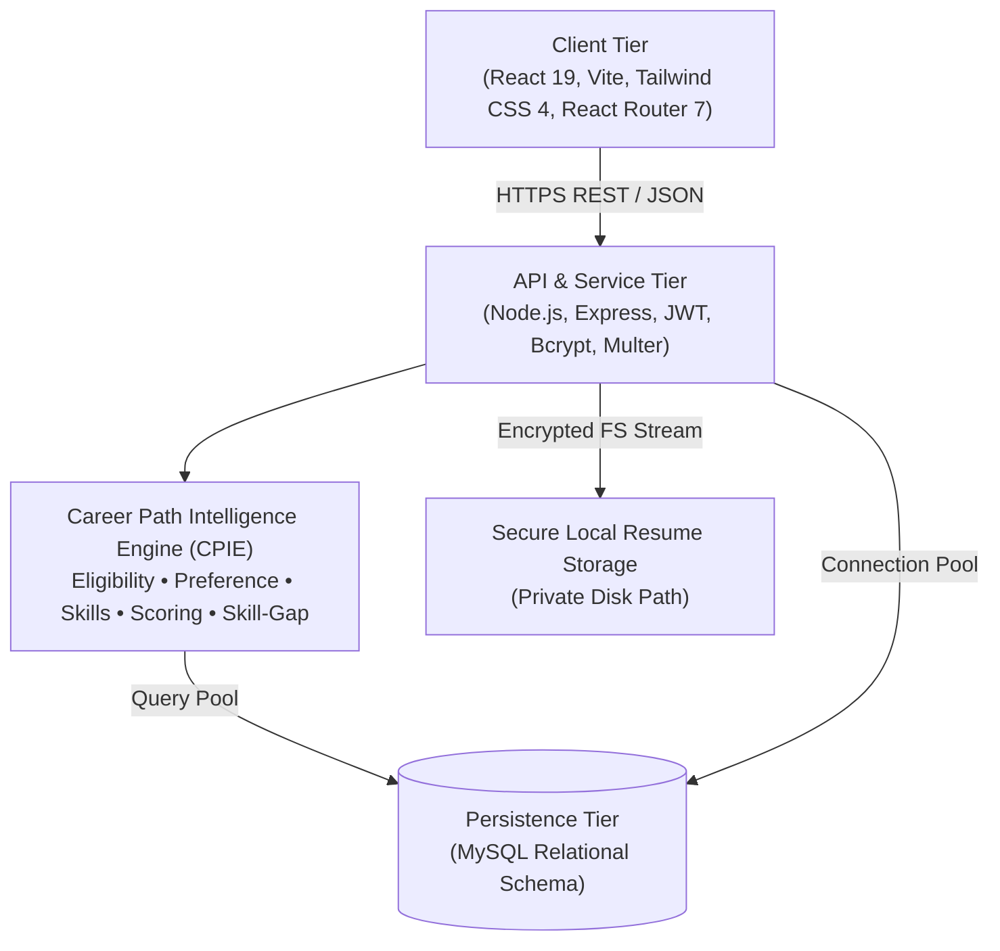
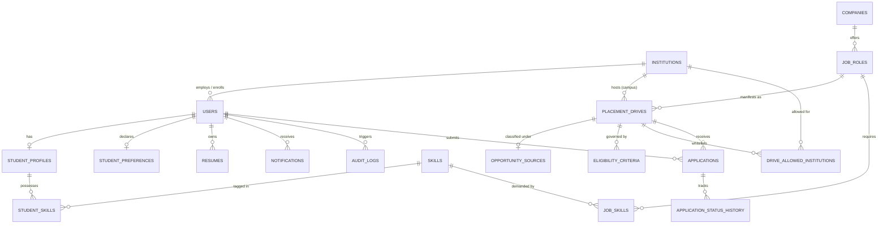
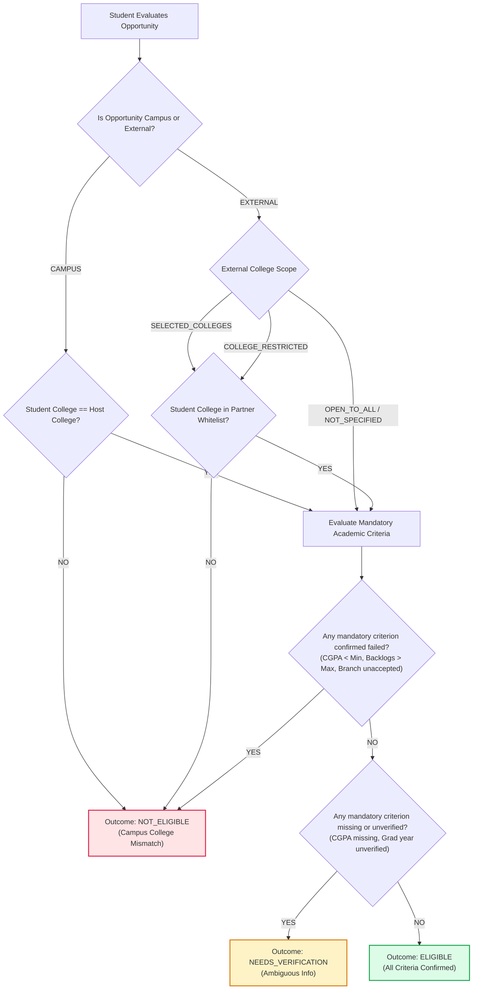

# PlaceWise — Multi-College Career & Placement Intelligence Platform

[](https://nodejs.org/)
[](https://www.mysql.com/)
[](https://react.dev/)
[](server/tests)

PlaceWise is a full-stack career and placement intelligence platform built for engineering students across all disciplines. It unifies **on-campus recruitment drives** with **verified off-campus opportunities**, audits real-time academic eligibility, and provides transparent, explainable recommendations without stereotyping students by their engineering branch.

---

## 1. Product Vision & Problem Statement

### The Problem
Traditional college placement management systems suffer from three critical flaws:
1. **Siloed Campus Visibility:** Students only see companies visiting their campus, missing out on off-campus opportunities, graduate engineering trainee programmes, and national hiring drives.
2. **Branch Stereotyping:** Systems infer career interests from academic branches (e.g., assuming Mechanical students only want core factory roles, or Computer Science students only want frontend coding).
3. **Opaque Ineligibility & Ghosting:** Students rarely understand *why* they failed an eligibility cut-off or which missing skills would have made them competitive.

### The PlaceWise Solution
- **Dual Opportunity Sourcing:** Seamlessly classifies and displays both **Campus Drives** and **External Opportunities** with verified provenance.
- **Four Explicit Preference Modes:** `TECHNICAL`, `NON_TECHNICAL`, `BOTH`, and `OPEN_TO_ALL`. Preference never changes academic eligibility.
- **Career Path Intelligence Engine (CPIE):**
  - **Eligibility Engine:** Evaluates mandatory requirements with deterministic outputs: `ELIGIBLE`, `NOT_ELIGIBLE`, and `NEEDS_VERIFICATION`. Confirmed failures always trump unverified fields.
  - **Explainable Ranking:** Configurable scoring formula: $\text{Score} = 0.40P + 0.35K + 0.15W + 0.10L$.
  - **Skill-Gap Impact Analysis:** Highlights the market frequency of missing desirable skills across all currently eligible openings.
  - **Feed Partitioning:** Partitions discovery into *Recommended For You* and *Explore Other Opportunities*. An eligible role is never hidden.
- **Multi-College Relational Architecture:** Built to support multiple institutions (Amity University Kolkata, Apex Institute, Metro Tech) with strict data isolation.

---

## 2. System Architecture



---

## 3. Database Entity-Relationship Diagram



---

## 4. CPIE Eligibility Resolution Flowchart



---

## 5. Technology Stack

- **Frontend:** React 19, Vite, Tailwind CSS 4, React Router 7, Lucide Icons.
- **Backend:** Node.js, Express, JWT, bcryptjs, Multer, connection pooling (`mysql2/promise`).
- **Database:** MySQL (normalized relational schema, migration scripts, demo seed data).
- **Testing:** Node.js native test runner (`node:test`), Supertest / Fetch integration test suites.
- **Storage:** Secure local development storage outside static web roots.

---

## 6. Directory Structure

```
PlaceWise/
├── client/                     # Frontend Application
│   ├── src/
│   │   ├── components/         # Reusable UI (Navbar, OpportunityCard, Badges, Modals)
│   │   ├── context/            # AuthContext, NotificationContext
│   │   ├── pages/              # 19 required views
│   │   │   ├── public/         # LandingPage, LoginPage, RegisterPage
│   │   │   ├── onboarding/     # OnboardingPage (Preference & Academic Setup)
│   │   │   ├── student/        # Dashboard, Profile, Preferences, Resumes, Opportunities, Applications, Settings
│   │   │   ├── admin/          # PlacementDashboard, CompanyManagement, DriveManagement
│   │   │   └── platform/       # ModerationQueue, InstitutionManagement
│   │   ├── services/           # API client module
│   │   ├── App.jsx             # Route definitions & RBAC guards
│   │   └── main.jsx
│   ├── tailwind.config.js
│   ├── vite.config.js
│   └── package.json
├── server/                     # Backend API & Intelligence Engine
│   ├── src/
│   │   ├── config/             # DB connection pool (127.0.0.1:3307 / 3306)
│   │   ├── controllers/        # auth, student, opportunity, application, admin, platform
│   │   ├── middleware/         # authGuard, requireRoles, institutionGuard, errorHandler
│   │   ├── services/
│   │   │   ├── cpie/           # Career Path Intelligence Engine
│   │   │   │   ├── eligibilityEngine.js
│   │   │   │   ├── preferenceMatcher.js
│   │   │   │   ├── skillCompatibility.js
│   │   │   │   ├── recommendationEngine.js
│   │   │   │   └── skillGapAnalyzer.js
│   │   │   ├── notificationService.js
│   │   │   └── storageService.js
│   │   ├── db/
│   │   │   ├── migrations/     # 001_initial_schema.sql
│   │   │   ├── seeds/
│   │   │   ├── migrate.js
│   │   │   └── seed.js
│   │   ├── app.js
│   │   └── server.js
│   ├── tests/                  # Automated test suites (CPIE + REST APIs)
│   ├── uploads/resumes/        # Private resume vault
│   ├── .env.example
│   └── package.json
├── docs/                       # Technical Specifications & ERD
└── README.md
```

---

## 7. Demonstration Accounts

All demonstration accounts use the password: `Demo@1234`

| Role | Email | Profile Details & Context |
|---|---|---|
| **Platform Admin** | `admin@placewise.io` | PlaceWise Platform HQ, moderation of external listings & colleges |
| **Placement Admin** | `placement@auk.placewise.io` | Amity University Kolkata Placement Cell Administrator |
| **Student (Technical)** | `rohan.cse@auk.edu` | Amity Kolkata, B.Tech CSE (2026), 8.80 CGPA, Mode: `TECHNICAL` |
| **Student (Both Domains)** | `ananya.ece@auk.edu` | Amity Kolkata, B.Tech ECE (2026), 7.60 CGPA, Mode: `BOTH` |
| **Student (Non-Technical)** | `vikram.me@auk.edu` | Amity Kolkata, B.Tech ME (2026), 7.10 CGPA, 1 Backlog, Mode: `NON_TECHNICAL` |
| **Student (Open to All)** | `sneha.it@apex.edu` | Apex Institute, B.Tech IT (2026), 8.40 CGPA, Mode: `OPEN_TO_ALL` |
| **Student (Unverified)** | `arpan.unverified@auk.edu` | Amity Kolkata, Civil Eng, incomplete CGPA (Tests `NEEDS_VERIFICATION`) |

---

## 8. Installation & Local Run Instructions

### Prerequisites
- Node.js v20+ and npm v10+
- MySQL Server (Homebrew or standard MySQL 8/9)

### 1. Database Setup
Ensure MySQL is running on port `3307` (or edit `server/.env` for `3306`):
```bash
# In server directory:
cd server
cp .env.example .env

# Run migrations and seed data
npm run db:setup
```

### 2. Run Backend Server
```bash
cd server
npm start
# Server listens on http://localhost:5005
```

### 3. Run Frontend Application
```bash
cd client
npm run dev
# Vite runs on http://localhost:3000 (proxies /api to http://localhost:5005)
```

### 4. Running the Automated Test Suite
```bash
cd server
npm test
```

### Verification Output:
```
✔ PlaceWise REST API & End-to-End Integration Tests (298ms)
✔ PlaceWise CPIE — Eligibility Engine Tests (2.6ms)
✔ PlaceWise CPIE — Career Preferences & Skill Compatibility Tests (1.9ms)
ℹ tests 27
ℹ suites 3
ℹ pass 27
ℹ fail 0
```

---

## 9. Known MVP Boundaries

1. **Password Reset:** Self-service email OTP verification is designed to hook into institutional SMTP services; for this MVP, credential updates are mediated by college placement administrators.
2. **Resume Parsing:** Automatic resume text extraction requires manual student confirmation before modifying profile fields, preventing unverified rejection.
3. **External Opportunity Feeds:** External listings are added and verified through admin moderation workflows rather than public web scraping.

---

## 10. License
PlaceWise is developed under the ISC License.

