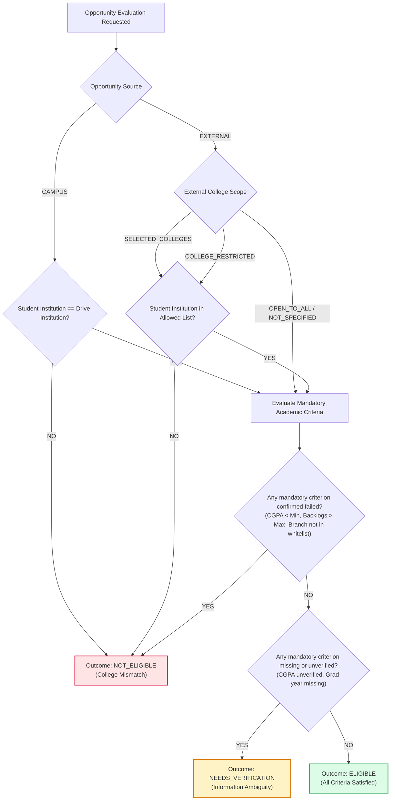
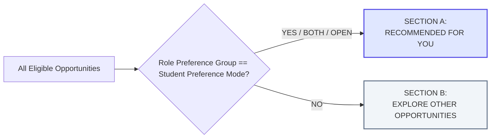

# PlaceWise Career Path Intelligence Engine (CPIE) Specification

CPIE is a decoupled backend intelligence layer designed to evaluate opportunities, provide explainable recommendations, and analyze marketplace skill gaps without conflating a student's academic background with their career goals.

---

## 1. Eligibility Engine Resolution Flow

### The Ineligibility Rule
> [!IMPORTANT]
> If an evaluation contains both a confirmed mandatory failure (e.g. CGPA is 6.8 vs required 7.5) and a missing field (e.g. graduation year unverified), the outcome **MUST BE RESOLVED AS `NOT_ELIGIBLE`**. A missing field cannot mask a confirmed failure.

---

## 2. Recommendation Engine Formulation

For all opportunities resolved as `ELIGIBLE`, CPIE computes an explainable ranking score:

$$\text{Score} = w_P \cdot P + w_K \cdot K + w_W \cdot W + w_L \cdot L$$

Default Configurable Weights:
- $w_P = 0.40$ (Preference Compatibility)
- $w_K = 0.35$ (Skill Compatibility)
- $w_W = 0.15$ (Work Mode Compatibility)
- $w_L = 0.10$ (Location Compatibility)

### 2.1 Preference Compatibility ($P \in [0, 100]$)
- Mode `TECHNICAL` + Role `TECHNICAL` $\to 100$; Role `NON_TECHNICAL` $\to 30$
- Mode `NON_TECHNICAL` + Role `NON_TECHNICAL` $\to 100$; Role `TECHNICAL` $\to 30$
- Mode `BOTH` $\to 100$ for all roles
- Mode `OPEN_TO_ALL` $\to 100$ for all roles

### 2.2 Skill Compatibility ($K \in [0, 100]$)
$$K = 0.60 \times \left(\frac{\text{Matched Mandatory Skills}}{\text{Total Mandatory Skills}}\right) + 0.40 \times \left(\frac{\text{Matched Desirable Skills}}{\text{Total Desirable Skills}}\right)$$
*Note: Missing desirable skills NEVER penalize academic eligibility.*

### 2.3 Work Mode Compatibility ($W \in [0, 100]$)
- Exact match or student is `OPEN` $\to 100$
- `HYBRID` mode overlap $\to 80$
- Direct mismatch (e.g. student wants Remote, role is In-Office) $\to 40$

### 2.4 Location Compatibility ($L \in [0, 100]$)
- Role is `REMOTE` or matches student preferred location list $\to 100$
- Non-matching physical location $\to 50$

---

## 3. Feed Partitioning Policy

---

## 4. Skill-Gap Market Impact Formulation

Across all currently `ELIGIBLE` opportunities for student $S$:

$$\text{Frequency}(sk) = \sum_{d \in \text{EligibleDrives}(S)} \mathbf{1}_{\{sk \in \text{DesirableSkills}(d) \land sk \notin \text{Skills}(S)\}}$$

Returns the ranked distribution of missing competencies with explicit user-facing disclaimers that this is an opportunity-frequency impact indicator, not an employment guarantee.
