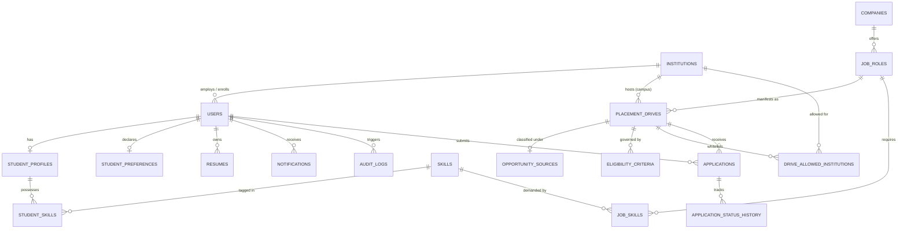

# PlaceWise Relational Schema & Entity-Relationship Documentation

## 1. Relational Schema Overview

PlaceWise utilizes a normalized relational schema on MySQL with strict multi-college isolation, foreign key constraints, cascading policies, and compound indexes.

---

## 2. Table Specifications

### 2.1 `institutions`
- `id` (INT, PK, AUTO_INCREMENT)
- `name` (VARCHAR(255), NOT NULL)
- `university_name` (VARCHAR(255), NULL)
- `code` (VARCHAR(50), NOT NULL, UNIQUE)
- `location` (VARCHAR(255), NOT NULL)
- `institution_type` (ENUM: `UNIVERSITY`, `AFFILIATED_COLLEGE`, `AUTONOMOUS_INSTITUTE`)
- `website` (VARCHAR(255), NULL)
- `is_active` (BOOLEAN, DEFAULT TRUE)
- `created_at`, `updated_at` (TIMESTAMP)

### 2.2 `users`
- `id` (INT, PK, AUTO_INCREMENT)
- `institution_id` (INT, NULL, FK -> institutions.id ON DELETE SET NULL)
- `email` (VARCHAR(255), NOT NULL, UNIQUE)
- `password_hash` (VARCHAR(255), NOT NULL)
- `role` (ENUM: `STUDENT`, `PLACEMENT_ADMIN`, `PLATFORM_ADMIN`, NOT NULL)
- `first_name`, `last_name` (VARCHAR(100), NOT NULL)
- `phone` (VARCHAR(20), NULL)
- `is_active` (BOOLEAN, DEFAULT TRUE)

### 2.3 `student_profiles`
- `id` (INT, PK, AUTO_INCREMENT)
- `user_id` (INT, NOT NULL, UNIQUE, FK -> users.id ON DELETE CASCADE)
- `student_id_code` (VARCHAR(100), NOT NULL)
- `degree` (VARCHAR(100), DEFAULT 'B.Tech')
- `branch` (VARCHAR(100), NOT NULL: e.g., CSE, IT, ECE, EE, ME, CE)
- `graduation_year` (INT, NOT NULL)
- `cgpa` (DECIMAL(4,2), NOT NULL)
- `active_backlogs` (INT, DEFAULT 0)
- `historical_backlogs` (INT, DEFAULT 0)
- `preferred_locations` (JSON, e.g. `["Bangalore", "Kolkata"]`)
- `preferred_work_mode` (ENUM: `IN_OFFICE`, `HYBRID`, `REMOTE`, `OPEN`)
- `bio` (TEXT, NULL)

### 2.4 `student_preferences`
- `id` (INT, PK, AUTO_INCREMENT)
- `user_id` (INT, NOT NULL, UNIQUE, FK -> users.id ON DELETE CASCADE)
- `preference_mode` (ENUM: `TECHNICAL`, `NON_TECHNICAL`, `BOTH`, `OPEN_TO_ALL`, NOT NULL)
- `updated_at` (TIMESTAMP)

### 2.5 `placement_drives`
- `id` (INT, PK, AUTO_INCREMENT)
- `institution_id` (INT, NULL, FK -> institutions.id ON DELETE CASCADE)
- `role_id` (INT, NOT NULL, FK -> job_roles.id ON DELETE CASCADE)
- `drive_code` (VARCHAR(50), NOT NULL, UNIQUE)
- `title` (VARCHAR(255), NOT NULL)
- `employment_type` (ENUM: `FULL_TIME`, `INTERNSHIP`, `PPO`)
- `work_mode` (ENUM: `IN_OFFICE`, `HYBRID`, `REMOTE`)
- `location` (VARCHAR(255), NOT NULL)
- `status` (ENUM: `DRAFT`, `PUBLISHED`, `CANCELLED`, `ARCHIVED`, `EXPIRED`)
- `application_deadline` (DATETIME, NOT NULL)
- `selection_rounds` (JSON)
- `required_documents` (JSON)

### 2.6 `opportunity_sources`
- `id` (INT, PK, AUTO_INCREMENT)
- `drive_id` (INT, NOT NULL, UNIQUE, FK -> placement_drives.id ON DELETE CASCADE)
- `source_type` (ENUM: `CAMPUS`, `EXTERNAL`, NOT NULL)
- `college_scope` (ENUM: `OPEN_TO_ALL_COLLEGES`, `SELECTED_COLLEGES`, `COLLEGE_RESTRICTED`, `NOT_SPECIFIED`)
- `official_url` (VARCHAR(500), NULL)
- `listing_source` (VARCHAR(150), NULL)
- `verification_status` (ENUM: `VERIFIED`, `PENDING_VERIFICATION`, `UNVERIFIED`, `EXPIRED`)
- `verified_by_user_id` (INT, NULL, FK -> users.id)
- `last_verified_date` (DATE, NULL)

